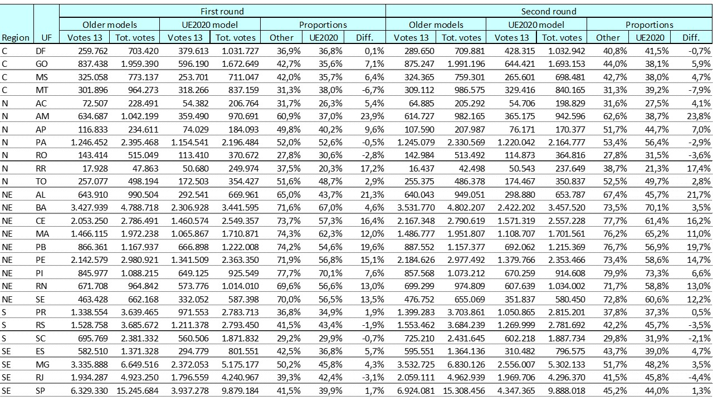
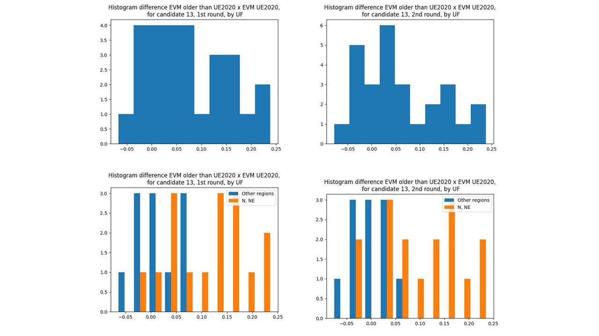
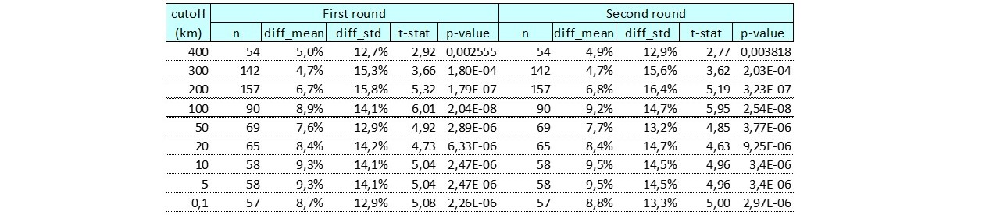
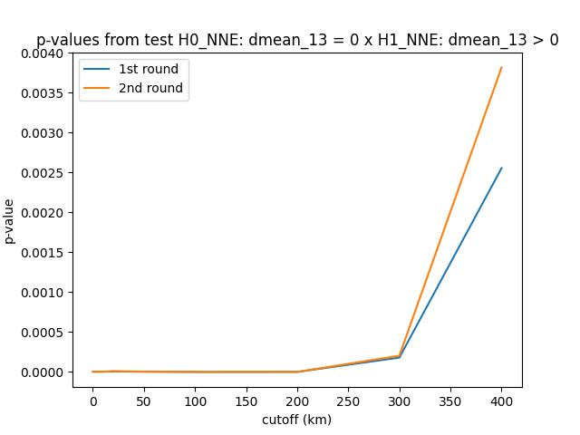
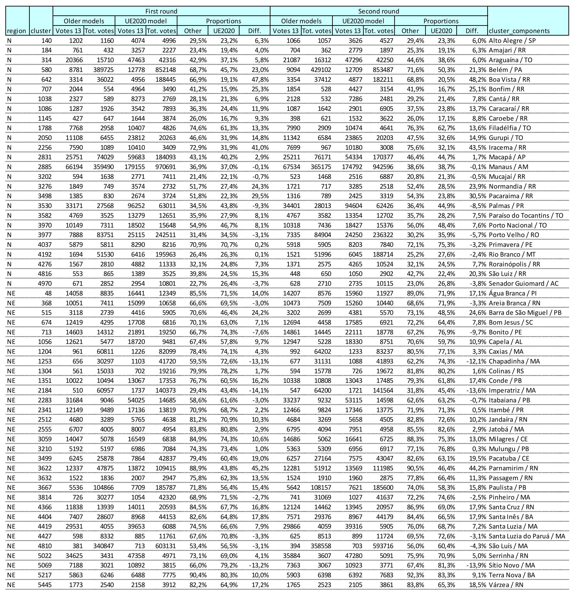
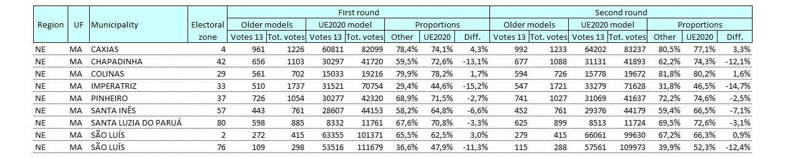

# Analysis of the `BrazilWasStolen` main claim

It was published by an Argentine, Fernando Cerimedo, in the website [BraziWasStolen.com](https://brazilwasstolen.com/en) a 76 page document with an analysis of the 2022 Brazilian Election for Presidency. The main claim in this document is that there is an anomalous difference in the proportion of votes for candidate 13 (Lula da Silva) in the electronic voting machines (EVMs) manufactured prior to 2020 (old models: UE2015, UE2013, etc.) than on those in the 2020 model (UE2020).

Why test the results from the 2020 model against those from the old models? Brazil uses a [direct-recording electronic voting machine]( https://en.wikipedia.org/wiki/DRE_voting_machine) without any print (paper trail) so as to allow the voter to check his vote as presented in the EVM with the one printed in the paper receipt. Since it is not possible to perform an *ex-post* audit of the votes by comparing the result of the prints with the recorded ones, one has to rely on an *ex-ante* auditing of the machines. However, according to the Argentinian website, only the 2020 model had auding reports available; the reports for the old models seemed to be missing. 

The objective of this work is to check the main claim mentioned above by means of a formal statistical test. In the next section we present the data that was used. Next, we explain the statistical procedure, and the corresponding results for different levels of aggregation of the electronic voting machines. In the last section we present our conclusions.


## Data

The data was downloaded from [BraziWasStolen.com](https://brazilwasstolen.com/en). However, the site is currently unstable, sometimes inaccessible from Brazil, possibly due to interference of the Electoral Supreme Court (TSE). In order to make the analysis possible to other researchers, we provided the Excel spreadsheet `VOTOS_T1E2.xlsx` in the folder `data`.

Some people were worried that this particular dataset might not have come from the [official TSE website](https://dadosabertos.tse.jus.br/). However a simple check on a sample of the number of votes for the candidates, at any aggregation level (state, municipality, electoral zone) indicates that the values in the spreadsheet are consistent with the ones presented at the official website. 

Nonetheless, we tried to download the original data from the [official TSE website](https://dadosabertos.tse.jus.br/), only to find that the data had been tampered: the data files inside the zip files have dates from 2022-11-07 22:00, one week after the election and after the publishing of the report in the Argentinian website, which, by itself, is highly suspicious.


## Methods

The assertion that old voting machine models yield a higher proportion of votes for Candidate 13 than the 2020 model can be tested using a **paired comparison design** (see, for example, Montgomery, 1983). The basic idea is to compare both treatments (the vote proportions in older vs. 2020 models) within the same experimental unit. In this context, an experimental unit is a geographically clustered aggregation of electronic voting machines that contains both older versions (UE2009, UE2013, etc.) and the newer version (UE2020).

We implicitly assume a random allocation of machines to electoral zones - since there is no structural reason to assume otherwise - though we will formally test this homogeneity hypothesis later. By utilizing "homogeneous" experimental units, we ensure that all known and unknown confounding factors (such as income, education, and social status) are kept constant across both treatments. Consequently, any observed difference in vote proportions can be more confidently attributed to the machine models themselves. This approach yields a much more powerful statistical test than a typical analysis of variance (ANOVA) or regression analysis, which can only improve statistical power by controlling for known factors.

Let's call *d* the difference between those proportions for a particular experimental unit. Under the null hypothesis of no difference in proportions, the mean *d* should be zero, against the alternative hypothesis that the mean *d* should be positive. That is, 

$$ H_{0}: \mu_{d} = 0 $$

$$ H_{1}: \mu_{d} > 0 $$


The test statistics for this hypothesis is

$$ t = \sqrt{n} \frac{ \overline{d} }{ s_{d} }$$

which has a standard t-student distribution with *n*-1 degrees of freedom under the null, and where $\overline{d}$ indicates the sample mean of *d* and $s_{d}$ its corresponding sample standard deviation. 


## Results

We performed our analysis for three aggregation levels:
- Units of the federation (UF): the states plus the federal district, where the capital of the country, Brasilia, is located.
- Clusters of municipalities (cities), based on their geographical distance from each other.
- Electoral zones.

### UFs as experimental units

For this case we developed the Python script `script_test_evm_uf.py`.

Table 1 and Figure 1 below illustrate the results for the first and second rounds of the election, with a total of 27 UFs, obtained by setting `region_option = 0` in the script above. Since the histograms suggest a bi- or tri-modal distribution, we also plotted the observed differences separating the UFs in the North (N) and North-eastern (NE) regions from the other UFs in the country.


*Table 1 – Proportions for candidate 13 in the EVMs older than UE2020 and EVM 2020, for all UFs, and respective differences, as given by the output file df_out_uf.csv*


*Figure 1 – Histograms for the differences in the proportion of votes to candidate 13 in EVMs older than UE2020 x EVM UE2020, in the first round (left) and in the second round (right), for all UFs (top) and discriminating the UFs in the N and NE regions from the UFs in the other regions (bottom).*

```
============================================================================================
                          Summary report for UF analysis                                    
============================================================================================

--------------------------------------------------------------------------------------------
Differences between proportion of votes for candidate 13 in EVMs older than UE2020 x UE2020
--------------------------------------------------------------------------------------------
1.Estimates for the first round:
 - Mean difference:                               7.2% 
 - Standard deviation difference:                 8.0% 
 - Lower bound for 95.0% confidence level:        4.0% 
 - Upper bound for 95.0% confidence level:       10.3% 
 - t_statistic:                                  4.65 
 - p-value:                                  4.21e-05 
 - Degrees of freedom:                             26 
2.Estimates for the second round:
 - Mean difference:                               6.3% 
 - Standard deviation difference:                 8.5% 
 - Lower bound for 95.0% confidence level:        2.9% 
 - Upper bound for 95.0% confidence level:        9.6% 
 - t_statistic:                                  3.85 
 - p-value:                                  3.44e-04 
 - Degrees of freedom:                             26 

--------------------------------------------------------------------------------------------
Transferred votes from the other candidates to 13 
--------------------------------------------------------------------------------------------
1.Estimates for first round:
 - Total valid votes:                      118,229,719      100.0%
 - Total votes in EVMs older than UE2020:   64,917,148       54.9%
 - Mean transferred votes:                   4,655,507        3.9%
 - Lower bound transferred votes:            2,598,422        2.2%
 - Upper bound transferred votes:            6,712,592        5.7%

2.Estimates for second round:
 - Total valid votes:                      118,552,353      100.0%
 - Total votes in EVMs older than UE2020:   65,090,929       54.9%
 - Mean transferred votes:                   4,081,498        3.4%
 - Lower bound transferred votes:            1,903,073        1.6%
 - Upper bound transferred votes:            6,259,923        5.3%

--------------------------------------------------------------------------------------------
Estimates of actual votes for 13 
--------------------------------------------------------------------------------------------
1.First round:
 - Total votes in the dataset               57,259,504       48.4%
 - Mean:                                    52,603,997       44.5%
 - Lower:                                   50,546,912       42.8%
 - Upper bound:                             54,661,082       46.2%

2.Second round:
 - Total votes in the dataset               60,345,999       50.9%
 - Mean:                                    56,264,501       47.5%
 - Lower:                                   54,086,076       45.6%
 - Upper bound:                             58,442,926       49.3%

--------------------------------------------------------------------------------------------
Estimates of actual votes for 22 
--------------------------------------------------------------------------------------------
1.First round:
 - Total votes in the dataset               51,072,345       43.2%
 - Mean:                                    55,727,852       47.1%
 - Lower:                                   53,670,767       45.4%
 - Upper bound:                             57,784,937       48.9%

2.Second round:
 - Total votes in the dataset               58,206,354       49.1%
 - Mean:                                    62,287,852       52.5%
 - Lower:                                   60,109,427       50.7%
 - Upper bound:                             64,466,277       54.4%

--------------------------------------------------------------------------------------------
Estimate of proportion of vote change from 22 to 13 (gross, due to Jensen's inequality) 
--------------------------------------------------------------------------------------------
1.First round:
 - Mean:                                           8.4%
 - Lower:                                          4.5%
 - Upper bound:                                   12.5%

2.Second round:
 - Mean:                                           6.6%
 - Lower:                                          3.0%
 - Upper bound:                                   10.4%

```

*Table 2 - Summary report for UF analysis, as given by the output file summary_UF.txt of `script_test_evm_UF.py`*

In the first round the sample mean difference between the proportion of valid votes to candidate 13 in the EVMs older than UE2020 versus the respective proportion in the EVM UE2020 was 7.2%, with a 95% confidence interval CI(4.0%, 10.3%), t-statistic of 4.65, p-value of 4.21e-05, and in the second round the mean difference was 6.3%, CI(2.9%, 9.6%), t-statistic of 3.85, p-value of 3.44e-04. Therefore, we reject H0, for both the first and the second rounds, at the usual significance levels. Or, in other words, we found compelling evidence, beyond a reasonable doubt, that the proportion of votes for candidate 13 in the older models was higher than that in the 2020 model, as stated by the Argentinian website "BrazilWasStolen".

Given these numbers, we can estimate other statistics. In the first round, given the total number of valid votes of 64.9mm in the older models, we could estimate the number of votes transferred from the other candidates to candidate 13 as around 4.7mm, CI(2.6, 6.7)mm votes, or 3.7%, CI(2.3%, 5.1%) valid votes. Also, since the number of valid votes to candidate 13 was 57.3mm, or 48.4% valid votes, given the estimated transferred votes, we could estimate the actual number of votes that candidate 13 received to be around 52.6mm, CI(50.5, 54.7)mm, or 44.5%, CI(42.8%, 46.2%) valid votes. Assuming all transferred votes came from candidate 22, and given that the total number of votes to candidate 22 was 51.1mm, 43.2% valid votes, we could estimate the actual number of votes to candidate 22 as around 55.7mm, CI(53.7, 57.8k), or 47.1%, CI(45.4%, 48.9%) valid votes.

In the second round, given the total number of valid votes of 65.1mm in the older models, we could estimate the number of votes transferred from the other candidates to candidate 13 as around 4.1mm, CI(1.9, 6.3)mm, or 3.4%, CI(1.6%, 5.3%) valid votes. Also, since the number of votes to candidate 13 was 60.3mm, 50.9% valid votes, given the estimated transferred votes, we could estimate the actual number of votes that candidate 13 received to be around 56.3mm, CI(54.1, 58.4)mm, or 47.5%, CI(45.6%, 49.3%) valid votes. Given that the total number of votes to candidate 22 was 58.2mm, 49.1% valid votes,we could estimate the actual number of votes to candidate 22 as around 62.3mm, CI(60.1, 64.4)mm, or 52.5%, CI(50.7%, 54.4%) valid votes.

Additionally, we could estimate the fraction of the votes that changed, possibly randomly, from the other candidates to candidate 13 to be 8.4%, CI(4.5%, 12.5%) in the first round, and 6.6%, CI(3.0%, 10.4%) in the second round. 

Eventually, in order to investigate the apparent bi- or tri-modality observed in Figure 1, we ran script `script_test_evm_UF.py` by setting `region_option = 1`, which corresponds to the UFs in the North and North-eastern regions, obtaining in the first round a mean difference of 11.2%, CI(7.1%, 15.2%), p-value 1.42e-5, with a corresponding fraction of transfer of votes of 15.9%, CI(9.6%, 23.0%), and in the second round a mean difference of 10.5%, CI(6.1%, 14.8%), p-value 5.92e-5, with a corresponding fraction of transfer of votes of 13.5%, CI(7.5%, 20.3%).

For the UFs other than those in the North and North-eastern regions, we ran the script by setting `region_option = 2`, obtaining in the first round a mean difference of 1.3%, CI(-1.4%, 4.1%), p-value 0.153, and in the second round a mean difference of 0.2%, CI(-2.6%, 3.0%), p-value 0.443, indicating that we fail to reject H0, which implies a lack of any evidence of transfer of votes from the other candidates to candidate 13 in these particular UFs.


### Clusters of cities as experimental units

After the analysis for the UFs in the previous section, some people raised the hypothesis that the observed differences might be due to a non-random allocation of the old machine models to places where candidate 13 would naturally have more votes. That is possible, though also strange: why would the TSE allocate the machine models not randomly in the UFs? Where is the procedure manual stating how this allocation should be? And worse, what are the cofounding factors that indicates higher probability of voting for one candidate or the other that correlate with the allocation of the EVM models?

However, there may be a caveat when using the UFs as experimental units, as they can be very large, in the sense that it is not possible to know if the known and unkown cofounding factors are really the same for both treatments in a UF. Thus, in order to obtain more "homogeneous" experimental units we could aggregate the machine models based on their haversine distance from each other by means of Cluster Analysis, and then sample those clusters with both the older and the new 2020 models (notice that, evidently, not all clusters formed in this manner will have both type of EVMs, and, therefore, have to be discharged from the analysis). The [haversine distance](https://en.wikipedia.org/wiki/Haversine_formula) is the distance along a maximum circle of a spherical surface of the Earth between two points, given their geographical coordinates (latitude and longitude). The clusters are formed by specifying a maximum (cut-off) distance between any of their members.

By varying the cut-off distance, from very large (say, 400 km) to very small (say, 0.1 km), we should observe every more homogeneous groups (clusters). For a sufficiently small distance, the cofounding factors should eventually be the same for both treatments in each cluster. As we decrease the cut-off distance, if the observed difference in treatments was due to different values of the cofounding factors for the treatments, we should fail to reject the original H0, observing increasing p-values. However, if on the contrary we still reject the original H0 after decreasing the cut-off distance, we would fail to infer any heterogeneity or differences in the values of cofounding factors in the so formed clusters.

Script `script_test_evm_cluster.py` implements the analysis described above for clusters formed from machine models in municipalities from the North and North-eastern regions of the country, since those regions were the source of the difference observed in the analysis for the UFs. The results obtained by varying the cut-off distance from 400 km to 0.1 km are presented in the Table 2 and Figure 2 below. In Table 3 we present the results for the most disaggregated level (at 0.1 km) which corresponds to only one member (municipality) per cluster.



*Table 2 – Summary of the p-values for the test, as a function of the cut-off distance (km), from `df_cutoff_NNE.csv`*



*Figure 2 – p-values for the test, as a function of the cut-off distance (km)*



*Table 3 – Proportions for candidate 13 in the old and new EVM models for the municipalities in the N and NE regions with both types of  models, and respective differences. These clusters were generated at the most disaggregated level (cut-off = 0.1 km), which corresponds to a single municipality (city) per cluster. Source: `df_cluster_NNE.csv`*


We can observe from Table 2 and Figure 2, that we reject H0 for all cut-off levels, with p-values well below the usual significance level (5%), even more so than in the previous UF analysis, implying that the observed difference in favour of candidate 13 in the old machine models is maintained at all aggregation levels of the machines, in the North and North-eastern region of the country, and is not due to cofounding factors or to a non random allocation of the EVMs.


### Electoral zones in the North and North-eastern region as experimental units

Eventually, the last level we could aggregate machine models is by electoral zone. Script `script_test_evms_zone.py` performs the analysis for the electoral zones in the North and North-eastern region. The results are presented in table 4 below.



*Table 4 – Proportions for candidate 13 in the old and new models for the electoral zones in the North and North-eastern regions with both types of models, and respective differences. Source: output `df_out_zone_NNE.csv`*

```
============================================================================================
                    Summary report for Electoral Zone analysis                              
============================================================================================

--------------------------------------------------------------------------------------------
Differences between proportion of votes for candidate 13 in EVMs older than UE2020 x UE2020
--------------------------------------------------------------------------------------------
1.Estimates for the first round:
 - Mean difference:                              -4.8% 
 - Standard deviation difference:                 6.8% 
 - Lower bound for 95.0% confidence level:      -10.0% 
 - Upper bound for 95.0% confidence level:        0.4% 
 - t_statistic:                                 -2.11 
 - p-value:                                  9.66e-01 
 - Degrees of freedom:                              8 
2.Estimates for the second round:
 - Mean difference:                              -5.1% 
 - Standard deviation difference:                 6.3% 
 - Lower bound for 95.0% confidence level:      -10.0% 
 - Upper bound for 95.0% confidence level:       -0.2% 
 - t_statistic:                                 -2.42 
 - p-value:                                  9.79e-01 
 - Degrees of freedom:                              8 

```

*Table 5 - Summary report for Electoral Zone analysis. Source: `summary_zone_NNE.txt`*

In the first round, the sample average difference was -4.8%, with a sample standard deviation of 6.8%, resulting in a t-statistic of -2.11, and corresponding p-value of 0.966.  In the second round, the sample average difference was -5.1%%, with a sample standard deviation of 6.3%, resulting in a t-statistic of -2.42, and corresponding p-value of 0.979.

Therefore, we failed to reject H0 at the usual significance levels for this sample of electoral zones. However, that is to be expected due to the very weak power of the test, since the sample is small (only 8 experimental units), biased (all electoral zones are from municipalities in the state of Maranhão, MA), and irrelevant (the total number of votes in the old models for the sampled experimental units is only 8181 and 8158 votes, for the first and second rounds, respectively).


## Conclusions

We confirm the assertion of "BrazilWasStolen" that the proportion of votes for candidate 13 in the old electronic voting machine models is significantly higher than those in the 2020 model, beyond a reasonable doubt. This difference amounts to circa 4 million votes (between 2 and 6 million votes, with a 95% confidence), in both first and second rounds, transferred from the other candidates to candidate 13, and more than enough to change the result of the election in favour of candidate 13.

We found no compelling evidence that this was the result of a non-random allocation of the old models to places where candidate 13 would have more votes. On the contrary, we found compelling evidence that the observed effect is maintained at every aggregation level of the municipalities and is not due to cofounding factors or to non random allocation of the machines.

Therefore, the actual reason for the observed significant difference must be something else.

## References

Montgomery, Douglas C., **Design and Analysis of Experiments**, Second Edition, John Wiley & Sons, 1983.
"# Brazilwasstolen_analysis"
